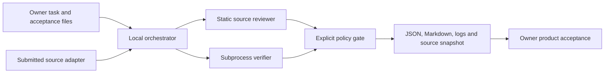

# Verifiable AI Agent Lab

A small Python framework for evaluating coding submissions using owner-defined
acceptance checks, source inspection, durable attempt records and explicit
uncertainty. **Trust reproducible evidence rather than AI consensus alone.**

**Implemented:** local submission adapter, structured tasks, dependency gates,
per-task attempt budgets, per-check deadlines and output limits, SQLite lifecycle
records, static source review, SHA-256 evidence binding, JSON/Markdown reports,
and explicit interrupted-run recovery.

**Verified demonstration:** a buggy miniature statistics package fails an
owner-side acceptance suite; a corrected submission passes the same suite.
Both submissions are deterministic fixtures. No model API, AI reviewer or live
multi-agent execution is represented by this demonstration.

## Motivation and architecture

Coding assistants can propose changes; acceptance must be supported by observable
behavior. A narrow static review and external acceptance checks provide different
signals, each with documented limits. This implementation is original standalone
software and has no dependency on a private orchestration system.



See [architecture and trust boundaries](docs/architecture.md).

## Installation and quick start

Requires Python 3.11 or newer. No runtime dependencies or paid API access.

```bash
python -m venv .venv
# Activate the environment using your platform's normal command.
python -m pip install ".[dev]"
vaal demo --output runs/demo
```

The expected sequence in `runs/demo/summary.json` is `FAIL`, then `PASS`.
Each attempt has a source snapshot, the owner inputs, raw check output,
`review.json`, `report.json`, and `report.md`. Use a fresh output directory to
repeat the demonstration; its two-attempt budget is persistent.

[Generated example report excerpt](docs/example-report.json) includes the measured
outcomes, with host-specific paths omitted. The runtime reports are authoritative.

## Evaluate your own trusted submission

Create an owner-controlled acceptance file **outside** the candidate directory.
Declare it in `input_files` so its bytes are archived and checked for changes.
Use an argument array, never a shell command string.

```json
{
  "id": "my-task-v1",
  "objective": "Describe observable behavior and unacceptable outcomes",
  "checks": [{
    "name": "owner-acceptance",
    "command": ["{python}", "-I", "/absolute/path/to/acceptance.py"],
    "input_files": ["/absolute/path/to/acceptance.py"]
  }],
  "timeout_seconds": 10,
  "max_attempts": 3
}
```

```bash
vaal run --task task.json --candidate candidate --output runs/task --execute-trusted-code
vaal recover my-task-v1 --output runs/task
```

Recovery marks an interrupted attempt `INCONCLUSIVE`; it never replays commands.
Inspect the original process before recovery. A changed task specification needs a
new task ID. Dependencies refer to task IDs with a completed technical `PASS` in
the same state database. They do not attest to external product deployment.

## Outcomes and verification

| Outcome | Meaning |
|---|---|
| PASS | Configured mandatory checks and the narrow review passed for the source snapshot |
| FAIL | A mandatory check failed or review found a confirmed defect |
| INCONCLUSIVE | Timeout, output overflow, changed evidence, or unresolved review concern |
| NOT_RUN | No mandatory execution evidence was configured or produced |
| BLOCKED | A dependency, executable or required owner acceptance is missing |

A successful optional check never overrides a failed mandatory check. A request
for owner acceptance stays blocked after technical checks; this version does not
include a human approval UI or dispatch a deployment.

```bash
python -m pytest -q
python -m ruff check src tests
python -m ruff format --check src tests
python -m build
```

Tests exercise fail-to-pass behavior, missing checks, dependency gates, source and
owner-input changes, deadlines, capped output, interrupted recovery and budgets.
GitHub Actions runs the checks and demo on Linux and Windows with Python 3.11/3.12.
See [validation evidence](docs/validation.md) for the actually observed results.

## Known limitations

This executes **trusted local code** with the current user's filesystem and network
access. It is not a sandbox. The environment excludes inherited credentials, but
host files remain accessible. On POSIX, a deadline terminates the process group;
on Windows, only the immediate process is guaranteed to be terminated. Run
untrusted or descendant-spawning workloads in a separately managed sandbox.

Static review checks Python syntax, bare `except`, and literal `shell=True` only.
A zero exit code and file hashes cannot establish general correctness, prevent a
malicious test from lying, or detect a file changed and restored between checks.
Owner acceptance files must be controlled independently of the submitter.
Dependencies, input-file declarations and check semantics are owner responsibilities.

The state store supports one active attempt per task. Multi-host dispatch,
concurrent worker recovery, live AI adapters, review disagreement analysis and
benchmark scores are **planned**, not implemented.

## Roadmap, references and license

[Prioritized milestones](ROADMAP.md) define acceptance criteria and verification.
No official benchmark performance is claimed. Public evaluation examples must
stay separate from held-out evaluation data.

References: [Anthropic's agent evaluation guidance](https://www.anthropic.com/research/demystifying-evals-for-ai-agents),
[Python subprocess documentation](https://docs.python.org/3/library/subprocess.html),
[PyPA packaging guide](https://packaging.python.org/en/latest/tutorials/packaging-projects/),
[pytest integration practices](https://docs.pytest.org/en/stable/explanation/goodpractices.html).
These informed the separation of tasks, trials and deterministic graders; this
repository is not an official implementation of any external benchmark.

MIT licensed original software. [Publication scope](docs/publication.md).
